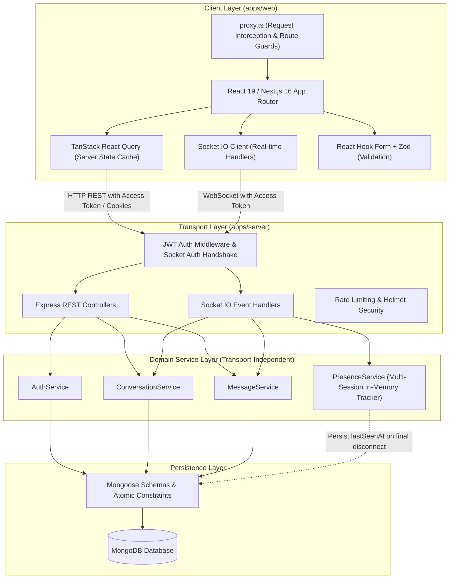
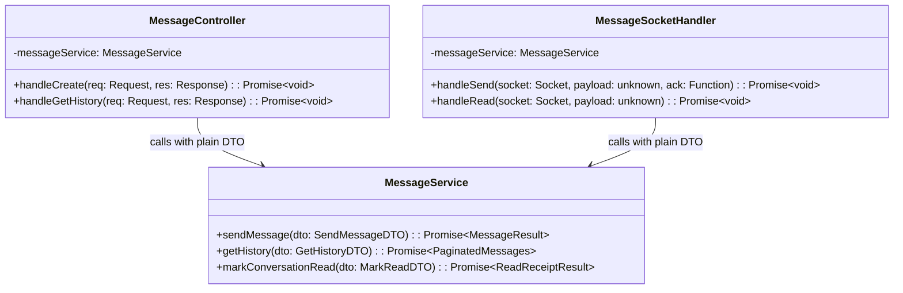
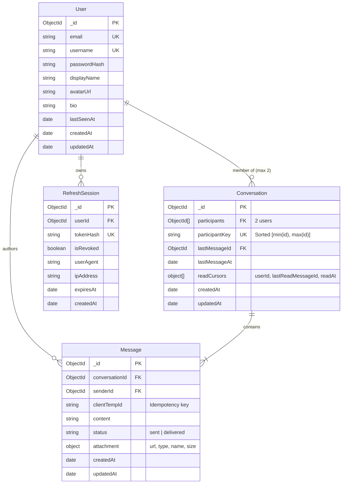

# Connectly — Architecture & Repository Design Document

## 1. System Overview

Connectly is a production-grade, real-time, private one-to-one messaging application built inside a Turborepo monorepo with Next.js 16 (App Router) on the frontend, Express + Socket.IO on the backend, and MongoDB (Mongoose) for persistence.



---

## 2. Monorepo Architecture & Verified Repository Baseline

All versions are verified directly from `package.json` and `pnpm-lock.yaml`:

| Package / Tool | Verified Version | Notes |
| :--- | :--- | :--- |
| **Node.js** | `>=24` (host `v24.20.0`) | Modern LTS runtime |
| **pnpm** | `11.25.0` | Monorepo package manager (`packageManager` field in root) |
| **Turborepo** | `2.11.10` | Build orchestration with task cache (`turbo.json`) |
| **Next.js** | `16.3.8` | App Router, Turbopack default engine |
| **React / React-DOM** | `19.2.8` | React 19 primitives (Actions, useOptimistic, ref as prop) |
| **TypeScript** | `7.0.2` | Strict mode enabled with `noUncheckedIndexedAccess: true` |
| **ESLint** | `10.9.1` | Flat config format (`eslint.config.js` / `eslint.config.mjs`) |
| **Docker / Compose** | Docker `29.9.2`, Compose `v5.1.4` | Containerization runtime available on host |

> [!IMPORTANT]
> **Dependency Compatibility Rule**: Never assume packages work together across React 19 and Next.js 16 without checking `package.json` and `pnpm-lock.yaml`. Every new dependency must be checked for peer-dependency compatibility before installation.

---

## 3. Core Architectural Refinements & Decisions

### 3.1 Transport-Independent Service Layer
To prevent duplicating business rules between HTTP routes and Socket.IO events, the backend strictly separates the **Transport Layer** from the **Domain Service Layer**:

- **Services** (`AuthService`, `ConversationService`, `MessageService`, `UserService`):
  - Accept pure DTOs and primitives (e.g., `{ conversationId: string, senderId: string, content: string, clientTempId: string }`).
  - Return plain domain objects or throw typed application errors (`NotFoundError`, `UnauthorizedError`, `ConflictError`, `ValidationError`).
  - **Never** accept or reference Express `req`, `res`, `next`, or Socket.IO `socket`, `io` instances.
- **Controllers / Socket Handlers**:
  - Express controllers handle HTTP status codes, parsing `req.body`, setting cookies, and error response mapping.
  - Socket.IO handlers parse incoming event payloads, call domain services, emit acknowledgments, and broadcast room events.



---

### 3.2 Presence & Multi-Session Connection Tracking
Persisting a simple `isOnline: boolean` in the database breaks as soon as a user has multiple tabs, windows, or devices open.

- **In-Memory Connection Registry (`PresenceManager`)**:
  - Maintains a thread-safe map: `userId -> Set<socketId>`.
  - When a socket connects:
    - If `activeSockets.size === 0`, user transitioned from offline to online.
    - Add `socketId` to `userId`'s set.
    - Broadcast `presence:change { userId, status: "online" }` to mutual conversation rooms.
  - When a socket disconnects:
    - Remove `socketId` from `userId`'s set.
    - Only when `activeSockets.size === 0`, user transitioned to offline.
    - Persist `lastSeenAt: new Date()` in the MongoDB `User` document.
    - Broadcast `presence:change { userId, status: "offline", lastSeenAt }` to mutual conversation rooms.
  - Designed behind a clear `IPresenceTracker` interface, making future horizontal scaling (via Redis Sets/Streams) a drop-in replacement.

---

### 3.3 Read Receipts & Conversation Read Cursors
Instead of performing unbounded database writes that update every individual `Message.status` in a long chat history:

1. **Conversation-Level Read Cursors**:
   - The `Conversation` schema maintains read cursors per participant:
     ```typescript
     readCursors: [
       {
         userId: mongoose.Types.ObjectId,
         lastReadMessageId: mongoose.Types.ObjectId,
         readAt: Date
       }
     ]
     ```
2. **Clear Message Lifecycle**:
   - **`sent`**: Successfully saved to MongoDB by the sender.
   - **`delivered`**: Recipient has at least one active connection registered in `PresenceManager` and the message payload was dispatched to their socket.
   - **`read`**: Recipient views the conversation, advancing their `lastReadMessageId` cursor in `Conversation`. A message with `_id <= lastReadMessageId` is resolved as read by that participant.
3. **Event Notification**:
   - When participant B opens conversation C, client emits `conversation:read { conversationId: C, messageId: M }`.
   - Backend updates `readCursors` for participant B in `Conversation` and broadcasts `conversation:read_update { conversationId, userId: B, lastReadMessageId: M, readAt }` to participant A.

---

### 3.4 Socket Message Sending & Idempotency
To prevent duplicate messages on network reconnects, retries, or flaky mobile connections:

1. **Client Temporary ID (`clientTempId`)**:
   - Every outbound message generated by the frontend is assigned a UUID v4 `clientTempId` prior to dispatch.
2. **Uniqueness Constraint**:
   - MongoDB `Message` model enforces a unique compound index on `{ conversationId: 1, senderId: 1, clientTempId: 1 }`.
3. **Persist-First Delivery Pipeline**:
   - **Step 1**: Socket handler receives `message:send` with `clientTempId`, `conversationId`, `content`.
   - **Step 2**: Authorize that `socket.user.id` is an active participant in `conversationId`.
   - **Step 3**: Attempt atomic insert into MongoDB. If duplicate key error occurs on `clientTempId`, fetch and return existing persisted message (idempotency guarantee).
   - **Step 4**: Return acknowledgment (`ack({ success: true, message: persistedMessage })`) directly to the sending socket.
   - **Step 5**: Broadcast `message:new { ...persistedMessage }` to the conversation room (excluding or tagged with `clientTempId` for sender deduplication).

---

### 3.5 Refresh Session Security — Expiration & Revocation Checks
The MongoDB TTL index is an asynchronous background cleanup job (runs every 60 seconds), **not** an access control mechanism. Relying on TTL deletion for authorization creates a vulnerability window.

- **Explicit Application-Level Verification**:
  Every `/api/auth/refresh` request must verify:
  1. Session record exists in MongoDB.
  2. `session.isRevoked === false`.
  3. `session.expiresAt > new Date()` (explicit clock check).
  4. Cryptographic hash matches stored `tokenHash`.
- **Token Rotation & Reuse Detection**:
  - Each refresh generates a new refresh token and invalidates the previous one (`isRevoked: true` or replaces `tokenHash`).
  - If a request is received with an already-revoked or expired refresh token, trigger a **security breach alert**: immediately revoke *all* active sessions for that `userId`.

---

### 3.6 Socket.IO Authentication & Token Lifecycle
- **Handshake Authentication**:
  - The client connects to Socket.IO supplying solely the short-lived access token:
    ```typescript
    io(SOCKET_URL, {
      auth: { token: accessToken }
    });
    ```
  - **Never** transmit the refresh token in socket payloads, query parameters, or handshakes.
- **Token Expiration Handling**:
  - When the access token expires or the connection drops with an auth error:
    1. The frontend socket manager catches the authentication error.
    2. Frontend triggers silent HTTP `POST /api/auth/refresh` (sending the secure `HttpOnly` cookie).
    3. On receiving the new access token, the socket client updates its `auth.token` option and reconnects cleanly without interrupting user experience.

---

## 4. Domain Data Model



### Essential Database Indexes
- **`User`**: `{ email: 1 }` (unique), `{ username: 1 }` (unique), `{ username: "text", displayName: "text" }` (user discovery).
- **`Conversation`**: `{ participantKey: 1 }` (unique: strictly prevents duplicate 1-to-1 chats), `{ participants: 1 }`, `{ lastMessageAt: -1 }`.
- **`Message`**: `{ conversationId: 1, senderId: 1, clientTempId: 1 }` (unique idempotency key), `{ conversationId: 1, createdAt: -1 }` (cursor pagination).
- **`RefreshSession`**: `{ tokenHash: 1 }` (unique), `{ userId: 1, isRevoked: 1 }`, `{ expiresAt: 1 }` (TTL background cleanup index).

---

## 5. Next.js 16 Request Interception (`proxy.ts`)
Next.js 16 replaces `middleware.ts` with `proxy.ts` located at `apps/web/proxy.ts`:

- Acts as a fast Edge/Node router for client redirects (e.g. redirecting unauthenticated users to `/login`).
- Does **not** replace backend server authorization. Every API route and Server Action independently validates access tokens and permissions.

---

## 6. Execution Plan & Quality Checklist

Each phase will be executed sequentially with zero regressions, strict type-checking, and comprehensive automated tests:

- **Phase 00**: Repository Audit & Architecture *(Complete with Refinements)*
- **Phase 01**: Monorepo Foundation (`apps/server`, shared contracts, environment validation, health check, Turborepo tasks)
- **Phase 02**: Database & Domain Foundation (MongoDB connection, User/Conversation/Message schemas, compound uniqueness, seed scripts)
- **Phase 03**: Authentication & Authorization (JWT dual-token, password hashing, secure cookie handling, React Hook Form + Zod login/register)
- **Phase 04**: Frontend Foundation & Chat UI (Tailwind tokens, responsive layout, dark/light themes, active conversation shell)
- **Phase 05**: User Search & Private Conversations (User discovery API/UI, deterministic 1-to-1 conversation creation)
- **Phase 06**: Message Persistence & HTTP API (Cursor-based pagination, message creation, optimistic UI)
- **Phase 07**: Socket.IO Real-Time Messaging (Event contracts, rooms, instant delivery, reconnect reconciliation)
- **Phase 08**: Presence, Typing, Read Receipts & Notifications (Multi-session connection tracking, typing debounce, read cursors)
- **Phase 09**: Image & File Sharing (Multer magic-byte verification, authenticated file streaming, preview components)
- **Phase 10**: Search, Profile & Settings (Profile/avatar edit, conversation search, notification preferences)
- **Phase 11**: Testing & Quality Review (Unit, integration, and UI test suites; type-check and lint verification)
- **Phase 12**: Docker & CI (Multi-stage Dockerfiles, Docker Compose, GitHub Actions workflow)
- **Phase 13**: Deployment & Documentation (Production guides, environment configs, final documentation)
