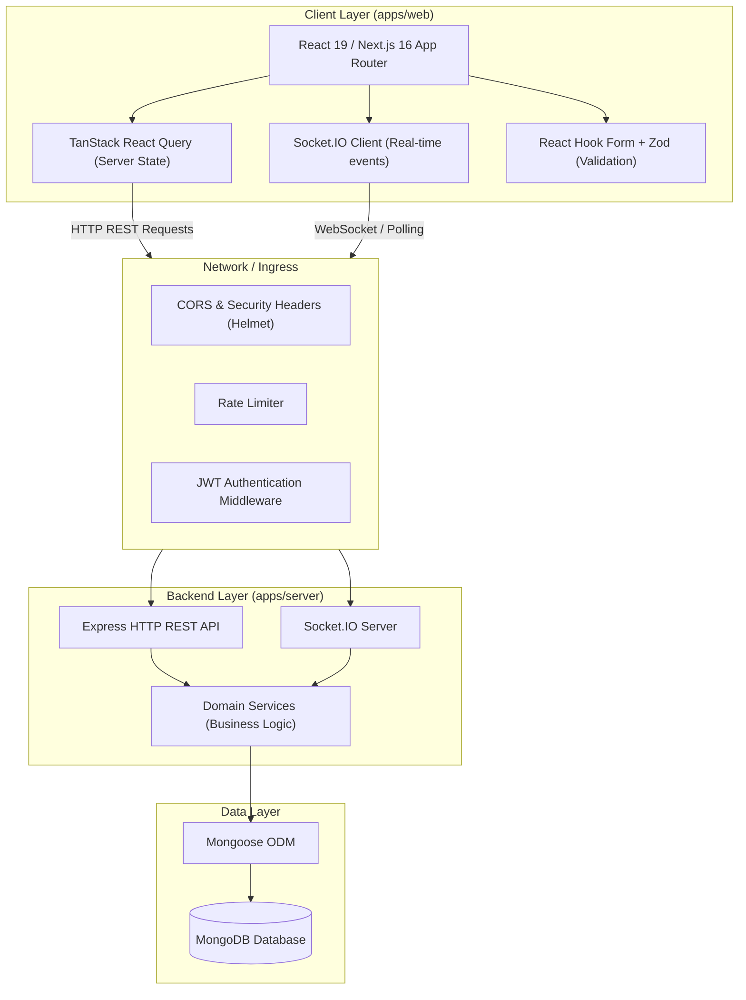
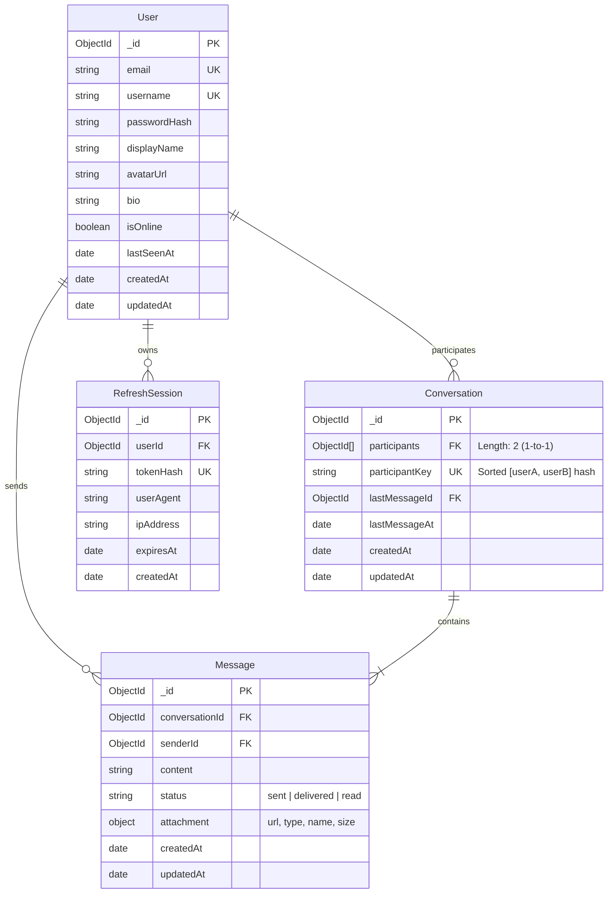
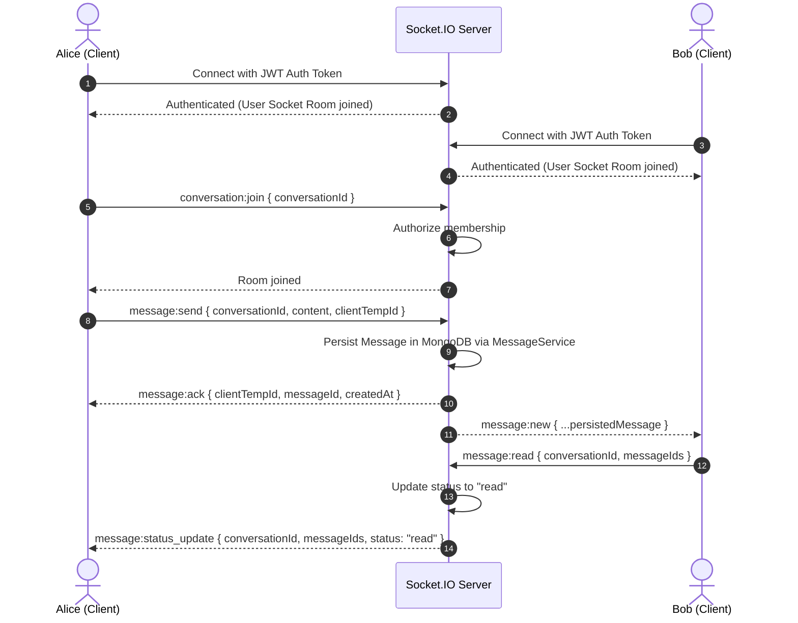

# Connectly — Architecture & Repository Design Document

## 1. System Overview

Connectly is a production-grade, real-time, private one-to-one messaging application built inside a Turborepo monorepo with Next.js 16 (App Router) on the frontend, Express + Socket.IO on the backend, and MongoDB (Mongoose) for persistence.



---

## 2. Monorepo Architecture

```text
connectly/
├── apps/
│   ├── web/                     # Next.js 16 App Router frontend (port 3000)
│   ├── server/                  # Express + Socket.IO backend (port 5000)
│   └── docs/                    # Internal documentation app (port 3001)
├── packages/
│   ├── ui/                      # Reusable UI component library (@repo/ui)
│   ├── eslint-config/           # Shared ESLint 10 flat configurations (@repo/eslint-config)
│   └── typescript-config/       # Shared TypeScript 7 compiler configs (@repo/typescript-config)
├── docs/                        # Architecture, API & deployment documentation
├── package.json                 # Monorepo root configuration (pnpm workspace)
├── pnpm-workspace.yaml          # Monorepo package directories
└── turbo.json                   # Turborepo task pipeline configuration
```

---

## 3. Technology Stack & Verified Versions

| Component | Technology | Version | Purpose |
| :--- | :--- | :--- | :--- |
| **Runtime** | Node.js | `>=24` (installed `v24.20.0`) | JavaScript runtime |
| **Package Manager** | pnpm | `11.25.0` | Workspace package manager |
| **Build System** | Turborepo | `2.11.10` | High-performance monorepo build orchestrator |
| **Frontend Framework** | Next.js | `16.3.8` | React Server Components, App Router, Turbopack |
| **Frontend UI** | React / React DOM | `19.2.8` | Core UI rendering with React 19 primitives |
| **TypeScript** | TypeScript | `7.0.2` | Strict type checking (`noUncheckedIndexedAccess`) |
| **Linter** | ESLint | `10.9.1` | Flat config (`eslint.config.js`) |
| **Backend Framework** | Express | `^4.21` / `^5.0` | Modular HTTP REST API server |
| **Real-Time Engine** | Socket.IO | `^4.8` | Bi-directional low-latency WebSocket communication |
| **Database & ODM** | MongoDB / Mongoose | `^8.10` | Document database and schema enforcement |
| **Validation** | Zod | `^3.24` / `^4.0` | Runtime request and schema validation |
| **Containerization** | Docker / Compose | Docker `29.9.2`, Compose `v5.1.4` | Containerized development and deployment |

---

## 4. Frontend & Backend Responsibilities

### Frontend (`apps/web`)
1. **Server Components by Default**: Non-interactive layouts, static metadata, and server-side route guards.
2. **Client Components for Interactivity**: Chat window, message composer, user search modal, socket connections.
3. **Request Interception**: Next.js 16 `proxy.ts` pattern for path-based authentication guards and session handling.
4. **State Segregation**:
   - Server state (conversations, messages history, user search results) managed by TanStack Query.
   - Real-time updates (incoming messages, typing, presence, receipts) handled by Socket.IO hooks and patched into TanStack Query cache.
   - Component state constrained to maximum 5 `useState` hooks per component; complex interactions decomposed into custom hooks (`useConversationSocket`, `useChatMessages`, `usePresence`).
5. **Form Management**: React Hook Form with Zod schema validation resolvers.

### Backend (`apps/server`)
1. **Layered Structure**:
   - `controllers/`: HTTP route handlers extracting and validating inputs.
   - `services/`: Core business logic decoupled from transport (reused across REST endpoints and Socket.IO events).
   - `models/`: Mongoose schemas with compound indexes and validation rules.
   - `socket/`: Socket event listeners, room management, and authorized event broadcasts.
   - `middleware/`: Authentication, authorization, rate limiting, and centralized error logging.
2. **Security & Session Management**:
   - Short-lived Access Token (JWT, 15m) + Long-lived Refresh Token (stored hashed in DB, 7-30d) rotated on use.
   - Secure HTTP-only cookies for refresh tokens (`SameSite=Lax`, `Secure`, `HttpOnly`).
   - Strict conversation membership authorization on every message/conversation operation.
   - File upload validation with magic-number inspection (`file-type`), strict size caps, and authenticated retrieval routes.

---

## 5. Domain Models & Indexing Strategy



### Essential Database Indexes
- **User**: `{ email: 1 }` (unique), `{ username: 1 }` (unique), `{ username: "text", displayName: "text" }` (user search).
- **Conversation**: `{ participantKey: 1 }` (unique: strictly prevents duplicate 1-to-1 conversations), `{ participants: 1 }`, `{ lastMessageAt: -1 }`.
- **Message**: `{ conversationId: 1, createdAt: -1 }` (fast cursor-based history pagination), `{ senderId: 1 }`, `{ conversationId: 1, status: 1 }` (unread receipts).
- **RefreshSession**: `{ tokenHash: 1 }` (unique), `{ userId: 1 }`, `{ expiresAt: 1 }` (TTL index for automatic session expiration).

---

## 6. Environment Variable Strategy

| Variable | Scope | Description |
| :--- | :--- | :--- |
| `NODE_ENV` | Global | `development` \| `production` \| `test` |
| `PORT` | `apps/server` | Backend listening port (default `5000`) |
| `MONGODB_URI` | `apps/server` | MongoDB connection connection string |
| `JWT_ACCESS_SECRET` | `apps/server` | Secret key for access token signing |
| `JWT_REFRESH_SECRET` | `apps/server` | Secret key for refresh token signing |
| `CORS_ORIGIN` | `apps/server` | Allowed origins (e.g. `http://localhost:3000`) |
| `UPLOAD_DIR` | `apps/server` | Local storage directory for media attachments |
| `NEXT_PUBLIC_API_URL` | `apps/web` | Base URL for REST API (e.g. `http://localhost:5000/api`) |
| `NEXT_PUBLIC_SOCKET_URL` | `apps/web` | Base URL for Socket.IO (e.g. `http://localhost:5000`) |

All environment variables will be validated at process startup using Zod schemas (`env.ts`). Turborepo pipeline caching will track relevant variables to avoid cache corruption.

---

## 7. Real-Time Socket.IO Contracts



